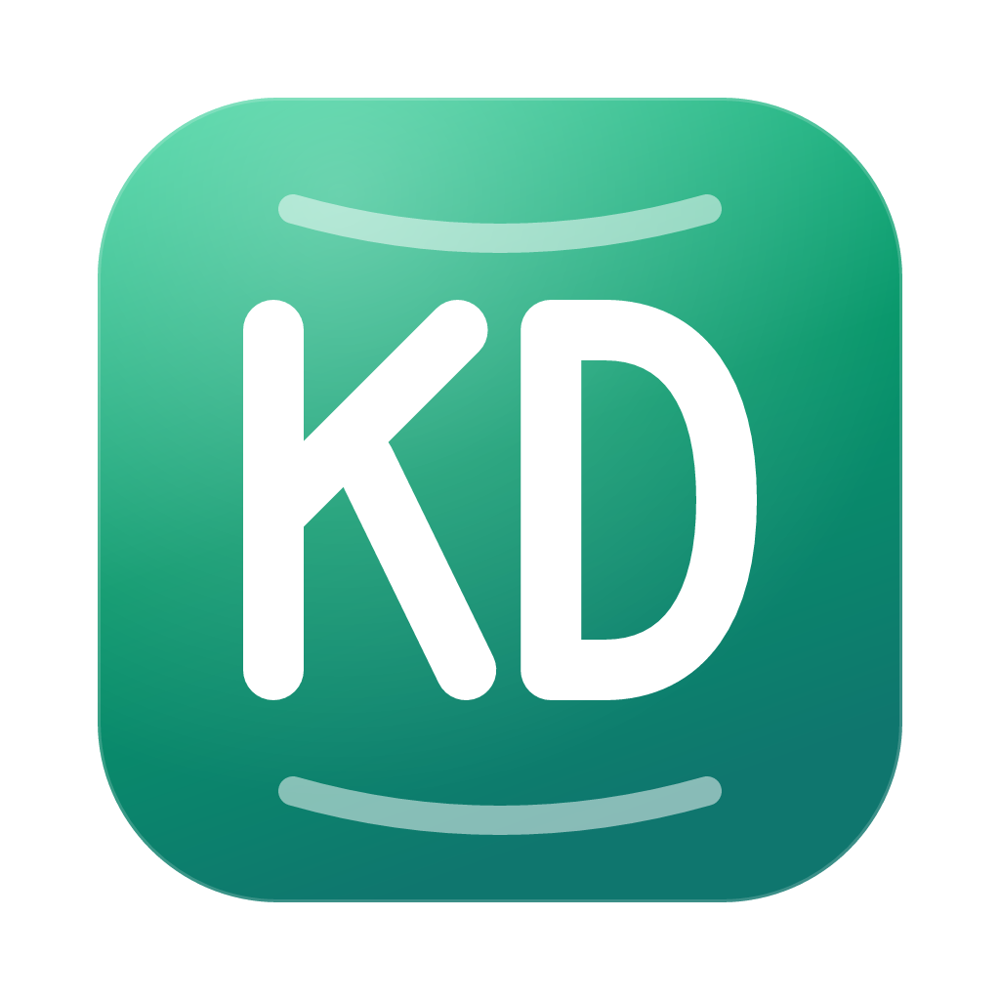

<p align="center">
  
</p>

<h1 align="center">KlikDB</h1>

<p align="center">
  A free, open-source, native database manager for macOS and Windows. PostgreSQL, MySQL, SQL Server, SQLite, Redis and MongoDB in one small app. Passwords stay in your OS keychain.
</p>

<p align="center">
  <a href="LICENSE"></a>
  
  
  
  <a href="https://github.com/ashafizullah/klikdb/actions/workflows/ci.yml"></a>
  <a href="https://github.com/ashafizullah/klikdb/releases/latest"></a>
</p>

<p align="center">
  <a href="https://trakteer.id/adamshafizullah/tip"></a>
</p>

> KlikDB was called **Tablory** up to 0.1.1. Your saved connections, passwords and query history carry over.

## Features

- **Six databases**: PostgreSQL, MySQL / MariaDB, SQL Server, SQLite, Redis and MongoDB
- **SSH tunnels** with a password or private key; passwords are stored in the OS keychain
- **Connection groups**: right-click the list for a new group, drag connections between groups
- **Navicat import** (File → Export Connections, `.ncx`), passwords included
- **Table browser** with server-side paging, sorting and filters (conditions or a raw `WHERE`)
- **Inline editing**: change cells, add and delete rows, preview the SQL, commit in one transaction (⌘S)
- **SQL editor** with highlighting and autocomplete; run the statement under the cursor (⌘↵) or everything (⇧⌘↵), cancel long queries
- **Table structure**: columns, indexes and foreign keys
- **Redis**: browse keys by pattern (SCAN), view and edit strings, hashes, lists, sets and sorted sets, set TTLs, rename and delete keys, and a command console
- **MongoDB**: browse collections with JSON filters and sorts, edit documents as Extended JSON, insert and delete documents, and run database commands; connect by host or by connection string
- **Auto-update** from GitHub Releases (signed packages; checked on launch and daily, or click the version number on the connections screen)

On SQL Server, separate batches with `GO` lines. A batch that changes data reports affected rows; any other batch shows its result sets. Cancelling a query ends the editor session, which reconnects on the next run.

Rows can only be edited in tables with a primary key, and an edit that does not match exactly one row rolls the whole commit back.

## Download

Get the latest version from **[Releases](https://github.com/ashafizullah/klikdb/releases/latest)**:

| Platform | File |
|---|---|
| macOS 11+ (Apple Silicon & Intel) | `KlikDB_x.y.z_universal.dmg` |
| Windows 10/11 (x64) | `KlikDB_x.y.z_x64-setup.exe` or `.msi` |

**macOS:** open the DMG and drag KlikDB into Applications. KlikDB is signed and notarized by Apple, so it opens without a Gatekeeper warning.

**Windows:** SmartScreen may warn about an unsigned app. Click **More info → Run anyway**.

## Shortcuts

| Key | Action |
| --- | --- |
| ⌘T | New SQL query |
| ⌘W | Close tab |
| ⌘S | Commit pending edits |
| ⌘R | Reload table |
| ⌘↵ / ⇧⌘↵ | Run statement / run all |
| ⌘K | Disconnect |
| ⌘F | Search tables |

## Development

Requires Node.js 22 and stable Rust.

```sh
npm install
npm run tauri dev      # run
npm run tauri build    # bundle
npm run check          # type checks
cargo test --manifest-path src-tauri/Cargo.toml
```

Integration tests run against local databases and an SSH bastion:

```sh
ssh-keygen -t ed25519 -N '' -f dev/ssh/id_ed25519   # once, test key for the bastion
docker compose -f dev/docker-compose.yml up -d --build
cd src-tauri && KLIKDB_TEST_DOCKER=1 cargo test
```

Without `KLIKDB_TEST_DOCKER` only the unit tests and the SQLite test run.

## Contributing

Issues and pull requests are welcome. CI runs type checks, the frontend build, `cargo fmt`, `clippy` and `cargo test`. Please run them locally before opening a PR.

### Releasing

Add a `## x.y.z` section to `CHANGELOG.md`, bump `version` in `tauri.conf.json`, `Cargo.toml` and `package.json`, then push a tag. CI builds the signed and notarized macOS DMG and the Windows installers, signs the update packages and attaches everything (including `latest.json` for the in-app updater) to a draft release. Publish the draft to roll it out: installed apps only see published releases.

Releases need the `TAURI_SIGNING_PRIVATE_KEY` secret (contents of `~/.tauri/tablory.key`, empty password; its public key is in `tauri.conf.json`) plus `APPLE_CERTIFICATE`, `APPLE_CERTIFICATE_PASSWORD`, `APPLE_ID`, `APPLE_PASSWORD` and `APPLE_TEAM_ID` for macOS signing and notarization.

```sh
git tag v0.1.0 && git push origin v0.1.0
```

## Support

KlikDB is free and always will be. If it saves you time, **[buy me an AI token on Trakteer](https://trakteer.id/adamshafizullah/tip)** ☕🤖.

<p align="center">
  <a href="https://trakteer.id/adamshafizullah/tip"></a>
  <br>
  <sub>Scan to support on Trakteer</sub>
</p>

## License

[MIT](LICENSE)
